  

<h3 align="center">Automating the path from commit to production ⚙️</h3>

  
  
  

---

### `$ cat about.md`

I'm **Prabhakant Tiwari**, a DevOps Engineer. I build and run the pipelines, containers and cloud infrastructure that let teams ship software quickly and safely.

- 🔁 **CI/CD:** automated build, test and deploy pipelines
- 🐳 **Containers:** packaging apps with Docker and running them on Kubernetes
- ☁️ **Cloud:** Azure and AWS, with infrastructure written as code
- 📈 **Observability:** metrics, dashboards and alerts so problems are seen early
- 🔭 **Working on:** *[your current project]*
- 🌱 **Learning:** *[what you are learning now]*

> My age and years of experience in the card above are calculated from dates, so they stay correct without any manual edit.

### `$ ./pipeline.sh`

  

### `$ ./stack --badges`

**Cloud** &nbsp;  

**CI/CD** &nbsp;   

**Containers** &nbsp;   

**IaC** &nbsp; 

**Observability** &nbsp;  

**Code and OS** &nbsp;    

### `$ ./contact.sh`

Open to DevOps, cloud and automation conversations. The quickest way to reach me is email: **prabhakantshandilya@gmail.com**, or send a message on [LinkedIn](https://www.linkedin.com/in/prabhakant-tiwari-86637476/).

<code>$ cat how-this-card-works.txt</code>

 

- The card switches between dark and light every 2 seconds.
- A GitHub Action rebuilds it every 6 hours.
- Age and experience are calculated from dates, so they update by themselves.
- Repos, stars, followers and commits come from the GitHub API.
- The ASCII portrait is generated from my GitHub profile picture, so it changes when I change the picture.

